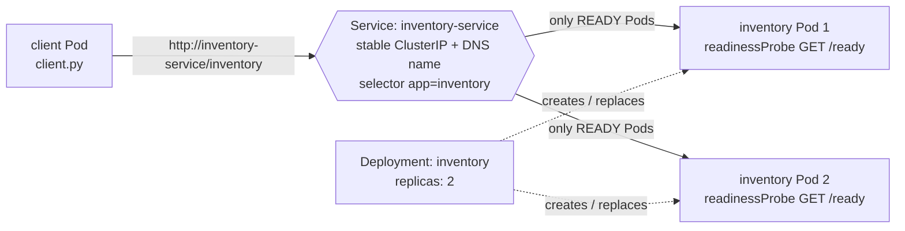
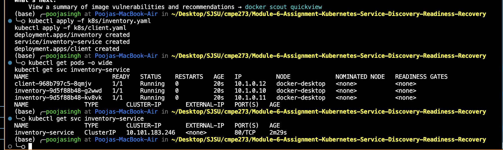
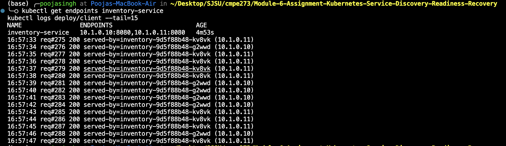
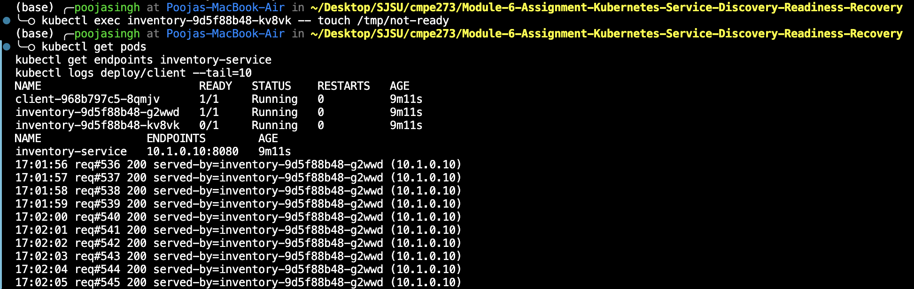
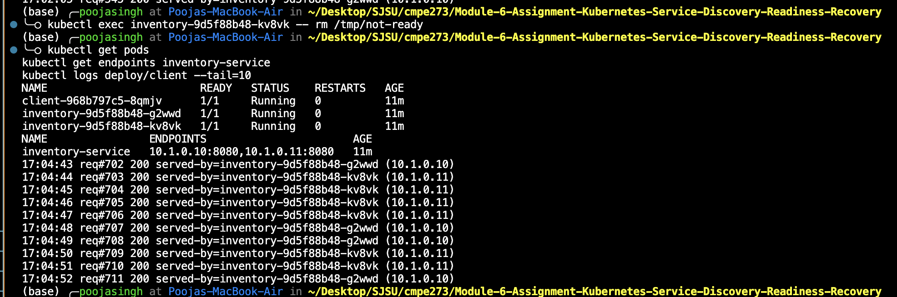
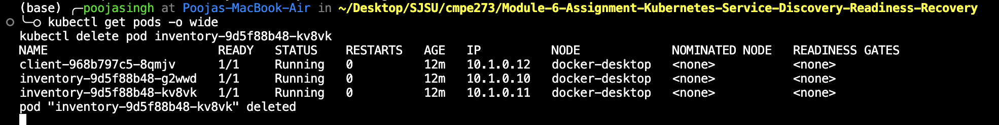
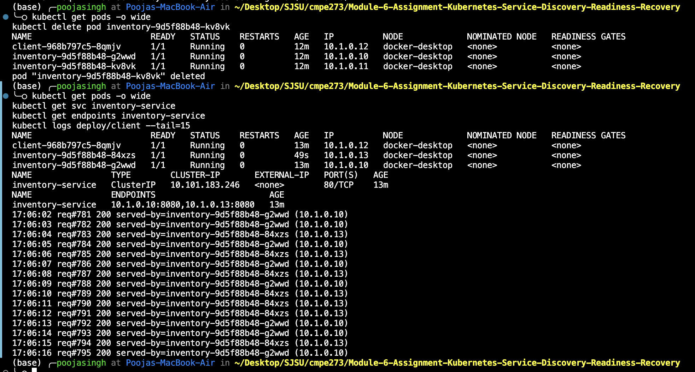

# CMPE 273 – Service Discovery, Readiness & Recovery on Kubernetes

A small Inventory application on Kubernetes (Docker Desktop Kubernetes): an **Inventory Service** with **2 replicas** behind a Kubernetes **Service**, and **1 client** that calls it by the Service name (`inventory-service`), never by Pod IP. The lab demonstrates load-balancing across replicas, a readiness failure and recovery, and Pod deletion and replacement.

**Language:** Python 3 (standard library only) · **Platform:** Docker Desktop Kubernetes

## Repository layout

| Path | Purpose |
|---|---|
| `app/inventory.py` | Inventory Service: `GET /inventory` (returns stock + the Pod's name), `GET /ready` (readiness), `GET /healthz` (liveness) |
| `app/client.py` | Client: calls `http://inventory-service/inventory` once per second and logs which Pod answered |
| `app/Dockerfile` | One image (`inventory-app:1.0`) used by both the service and the client |
| `k8s/inventory.yaml` | Deployment (2 replicas, readiness + liveness probes) and the `inventory-service` Service |
| `k8s/client.yaml` | Client Deployment (1 replica) |
| `evidence/` | Terminal output from each test |
| `screenshots/` | Screenshots from the run |

## Architecture



```
                                   +--------------------------------+
 [ client Pod ] --- DNS name --->  |  Service: inventory-service    |
  calls http://inventory-service   |  (stable ClusterIP, port 80)   |
                                   +---------------+----------------+
                                       only READY  |  Pods (Endpoints)
                                   +---------------+----------------+
                                   v                                v
                         [ inventory Pod 1 ]              [ inventory Pod 2 ]
                          :8080, /ready probe              :8080, /ready probe
                                   ^                                ^
                                   +---- Deployment (replicas: 2) --+
                                         recreates any deleted Pod
```

Key design choices:

- **Service discovery by name.** The client only knows `inventory-service`. Cluster DNS resolves that to the Service's stable ClusterIP, and kube-proxy forwards each connection to one of the Service's **ready** endpoints.
- **New connection per request.** The client opens a fresh connection for every call, so each request is balanced independently and both replicas show up in the logs.
- **Readiness probe** (`GET /ready` every 2s, `failureThreshold: 1`). When `/tmp/not-ready` exists inside a Pod, `/ready` returns 503, Kubernetes marks the Pod `0/1 READY`, and removes it from the Service endpoints. The container keeps running.
- **Liveness probe** (`GET /healthz`) always passes, so a readiness failure never causes a restart. This keeps the two concepts separate.
- **Deployment with `replicas: 2`.** If a Pod is deleted, the ReplicaSet creates a replacement with a new name and IP, and the Service picks it up automatically.

## How to deploy

Prerequisites: Docker Desktop with Kubernetes enabled (Settings → Kubernetes → Enable Kubernetes), and `kubectl` pointing at it:

```bash
kubectl config use-context docker-desktop
kubectl get nodes          # STATUS should be Ready
```

**1. Build the image** (Docker Desktop Kubernetes uses local images directly):

```bash
docker build -t inventory-app:1.0 ./app
```

> Using **kind** instead? Also run `kind load docker-image inventory-app:1.0`.
> Using **minikube**? Run `minikube image load inventory-app:1.0`.

**2. Deploy the Inventory Service and the client:**

```bash
kubectl apply -f k8s/inventory.yaml
kubectl apply -f k8s/client.yaml
kubectl get pods -o wide
kubectl get svc inventory-service
```

**3. Watch the client:**

```bash
kubectl logs -f deploy/client
```

**4. Clean up when done:**

```bash
kubectl delete -f k8s/
```

## Results

All output is from a real run on Docker Desktop Kubernetes (v1.32.2). Full terminal output is in [`evidence/`](evidence/). Log timestamps come from inside the containers, which use UTC.

### 1. Deploy: both Pods running, client uses the Service name, requests reach both replicas

**Both Inventory Pods are running**, plus the client. The Service `inventory-service` has a stable ClusterIP:

```
NAME                         READY   STATUS    RESTARTS   AGE   IP
client-968b797c5-8qmjv       1/1     Running   0          20s   10.1.0.12
inventory-9d5f88b48-g2wwd    1/1     Running   0          20s   10.1.0.10
inventory-9d5f88b48-kv8vk    1/1     Running   0          20s   10.1.0.11

NAME                TYPE        CLUSTER-IP       EXTERNAL-IP   PORT(S)
inventory-service   ClusterIP   10.101.183.246   <none>        80/TCP
```

The Service has **both Pods as endpoints**:

```
NAME                ENDPOINTS
inventory-service   10.1.0.10:8080,10.1.0.11:8080
```

**The client reaches Inventory by Service name.** It is configured with `INVENTORY_URL=http://inventory-service/inventory` (see `k8s/client.yaml`) and never uses a Pod IP. Its log shows **requests answered by both replicas**:

```
16:57:33 req#275 200 served-by=inventory-9d5f88b48-kv8vk (10.1.0.11)
16:57:34 req#276 200 served-by=inventory-9d5f88b48-g2wwd (10.1.0.10)
16:57:35 req#277 200 served-by=inventory-9d5f88b48-kv8vk (10.1.0.11)
...
16:57:39 req#281 200 served-by=inventory-9d5f88b48-g2wwd (10.1.0.10)
16:57:40 req#282 200 served-by=inventory-9d5f88b48-g2wwd (10.1.0.10)
...
16:57:46 req#288 200 served-by=inventory-9d5f88b48-g2wwd (10.1.0.10)
16:57:47 req#289 200 served-by=inventory-9d5f88b48-kv8vk (10.1.0.11)
```




### 2. Readiness failure and recovery

**Make one Pod fail readiness.** Creating `/tmp/not-ready` inside `kv8vk` makes its `/ready` endpoint return 503:

```bash
kubectl exec inventory-9d5f88b48-kv8vk -- touch /tmp/not-ready
```

- **The Pod is still running.** `kv8vk` shows `0/1` READY, but STATUS is still `Running` with **0 restarts**. Readiness does not kill the container.
- **The unready Pod stops receiving traffic.** Kubernetes removed it from the Service endpoints. Only `10.1.0.10` is left.
- **The other ready Pod keeps serving.** All 10 requests went to `g2wwd`, all 200 with no errors.

```
NAME                         READY   STATUS    RESTARTS   AGE
inventory-9d5f88b48-g2wwd    1/1     Running   0          9m11s
inventory-9d5f88b48-kv8vk    0/1     Running   0          9m11s

NAME                ENDPOINTS        AGE
inventory-service   10.1.0.10:8080   9m11s

17:01:56 req#536 200 served-by=inventory-9d5f88b48-g2wwd (10.1.0.10)
17:01:57 req#537 200 served-by=inventory-9d5f88b48-g2wwd (10.1.0.10)
...
17:02:05 req#545 200 served-by=inventory-9d5f88b48-g2wwd (10.1.0.10)
```



**Restore readiness.** Remove the flag:

```bash
kubectl exec inventory-9d5f88b48-kv8vk -- rm /tmp/not-ready
```

`kv8vk` returns to `1/1` (still **0 restarts**, so it is the same Pod), is added back to the endpoints, and **receives traffic again**:

```
NAME                         READY   STATUS    RESTARTS   AGE
inventory-9d5f88b48-g2wwd    1/1     Running   0          11m
inventory-9d5f88b48-kv8vk    1/1     Running   0          11m

NAME                ENDPOINTS                         AGE
inventory-service   10.1.0.10:8080,10.1.0.11:8080     11m

17:04:43 req#702 200 served-by=inventory-9d5f88b48-g2wwd (10.1.0.10)
17:04:44 req#703 200 served-by=inventory-9d5f88b48-kv8vk (10.1.0.11)
17:04:45 req#704 200 served-by=inventory-9d5f88b48-kv8vk (10.1.0.11)
...
```



### 3. Pod failure and recovery

**Delete one Inventory Pod:**

```bash
kubectl delete pod inventory-9d5f88b48-kv8vk
```

| | Before | After |
|---|---|---|
| Inventory Pod 1 | `inventory-9d5f88b48-g2wwd` (10.1.0.10) | `inventory-9d5f88b48-g2wwd` (10.1.0.10), untouched |
| Inventory Pod 2 | `inventory-9d5f88b48-kv8vk` (10.1.0.11) | **`inventory-9d5f88b48-84xzs` (10.1.0.13)**, new name, new IP, age 49s |
| Service name | `inventory-service` | `inventory-service` |
| Service ClusterIP | `10.101.183.246` | `10.101.183.246` |
| Endpoints | `10.1.0.10:8080,10.1.0.11:8080` | `10.1.0.10:8080,10.1.0.13:8080` |

- **Kubernetes creates a replacement Pod.** The Deployment's ReplicaSet saw only 1 of 2 replicas and created `84xzs`.
- **The new Pod has a different identity.** Its name is `84xzs` instead of `kv8vk`, and its IP is `10.1.0.13` instead of `10.1.0.11`.
- **The Service name stays the same.** `inventory-service` keeps the same ClusterIP. Only the endpoints behind it changed.
- **The client keeps communicating through the Service.** With no configuration change, it is now served by the new Pod:

```
17:06:02 req#781 200 served-by=inventory-9d5f88b48-g2wwd (10.1.0.10)
17:06:03 req#782 200 served-by=inventory-9d5f88b48-g2wwd (10.1.0.10)
17:06:04 req#783 200 served-by=inventory-9d5f88b48-84xzs (10.1.0.13)
17:06:05 req#784 200 served-by=inventory-9d5f88b48-g2wwd (10.1.0.10)
17:06:06 req#785 200 served-by=inventory-9d5f88b48-84xzs (10.1.0.13)
...
17:06:16 req#795 200 served-by=inventory-9d5f88b48-g2wwd (10.1.0.10)
```




## Reflection

**Why is a stable Service name useful when Pods can fail or be replaced?**

Pods are disposable: when one crashes or is deleted, Kubernetes replaces it with a new Pod that has a different name and a different IP address, so any client that hard-coded a Pod address would break. A Service gives a group of Pods one stable DNS name and virtual IP that never changes, and Kubernetes keeps the list of Pods behind it up to date automatically. Combined with readiness probes, that list contains only Pods that are actually able to serve, so traffic is steered away from an unhealthy Pod without the client doing anything. The client just keeps calling `inventory-service`, and failures, replacements, and scaling happen behind that name without any configuration change or downtime.
